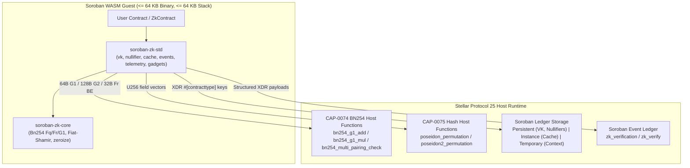

# Soroban-ZK-Std Architecture

`Soroban-ZK-Std` is a `#![no_std]` Rust cryptographic standard library and
smart-contract verification stack built for **Stellar Protocol 25 (X-Ray)**. It
bridges pure BN254 and hash arithmetic with Soroban's native cryptographic host
functions (CAP-0074 and CAP-0075) while respecting Soroban's strict WASM binary,
stack, CPU instruction, and ledger archival constraints.

---

## 1. Layered Workspace Architecture

The Cargo workspace enforces a strict one-way dependency boundary between pure
cryptography, Soroban host integration, and deployable smart contracts.

```text
+-----------------------------------------------------------------------------+
|                        Layer 3: Reference Contracts                         |
|  contracts/verifier-sample          contracts/shielded-asset-template       |
|  (WASM footprint / budget probe)    (ElGamal shielded transfers + Groth16)  |
+--------------------------------------+--------------------------------------+
                                       | depends on (default-features = false)
                                       v
+-----------------------------------------------------------------------------+
|                    Layer 2: crates/soroban-zk-std                           |
|  - Protocol 25 Host Bridge (host.rs, pairing.rs, poseidon2.rs)              |
|  - Proof Verifiers (groth16.rs, plonk_kzg.rs, halo2.rs)                     |
|  - On-Ledger State (vk.rs chunked VK & VerificationContext, cache.rs,       |
|                     nullifier.rs anti-replay)                               |
|  - Observability (events.rs, telemetry.rs) & Gadgets (boolean, lut, sha256) |
+--------------------------------------+--------------------------------------+
                                       | depends on
                                       v
+-----------------------------------------------------------------------------+
|                    Layer 1: crates/soroban-zk-core                          |
|  Pure #![no_std] Math — ZERO Soroban SDK dependencies (only ethnum v1.5.3)  |
|  - BN254 Fq / Fr / Fq2 / G1 arithmetic & subgroup checks (lib.rs, g1.rs)    |
|  - Proof math (groth16, plonk, halo2_ipa, bulletproofs, polynomial)         |
|  - Hashing & word packing (poseidon2, rescue, sha256_padding, sha256_words) |
|  - Memory hygiene (zeroize::{SensitiveBuffer, SensitiveVec})                |
+-----------------------------------------------------------------------------+
```

### Guest-vs-Host Execution Boundary (Protocol 25)



### Crate Separation Rules

| Crate / Path | Dependencies | Responsibilities | Forbidden |
| --- | --- | --- | --- |
| `crates/soroban-zk-core` | `ethnum` (`default-features = false`) only | Pure field/curve math, proof algebra, FIPS-180-4 SHA-256 helpers, `SensitiveBuffer` zeroization, `ZkError` | `std::`, `soroban-sdk`, ledger storage, panics in library paths |
| `crates/soroban-zk-std` | `soroban-zk-core`, `soroban-sdk` (`default-features = false`), `ethnum` | Host-guest big-endian conversion (`HostConvert`, `host.rs`), CAP-0074/CAP-0075 calls, chunked VK storage, `NullifierStore`, `cache`, `events`, `telemetry`, `gadgets`, optional `ZkContract` (`contract` feature) | Unbounded recursion, unvalidated curve coordinates crossing host boundary |
| `contracts/*` | `soroban-sdk`, `soroban-zk-std` (`default-features = false`) | Application auth (`require_auth`), business state transitions, reference WASM size/budget benchmarks | Duplicating low-level curve math |

Downstream contracts disable `soroban-zk-std`'s default `contract` feature so
`ZkContract`'s exported entry points are not linked into their WASM binary.

---

## 2. Soroban Resource & Memory Invariants

### 2.1 WASM Binary Size Limit (64 KB)

Soroban enforces a hard **64 KB (`65,536` bytes)** maximum contract WASM size.
The workspace `[profile.release]` in `Cargo.toml` enforces aggressive size
optimization across all crates:

```toml
[profile.release]
opt-level = "z"
overflow-checks = true
debug = 0
strip = "symbols"
debug-assertions = false
panic = "abort"
codegen-units = 1
lto = true
```

- `make wasm-size-check` builds `verifier-sample` for `wasm32v1-none` and fails
  CI if `verifier_sample.wasm` exceeds `65,536` bytes.
- Baseline audited footprints in `WASM_SIZES.md` are `2,093 B` (`verifier-sample`)
  and `2,153 B` (`shielded-asset-template`).
- Pull requests that grow `verifier-sample` by more than `5 KB` require explicit
  optimization justification (`twiggy top` analysis).

### 2.2 Linear Stack Budget (64 KB) & Memory Hygiene

Soroban WASM guests execute with a constrained **64 KB linear stack**:

- **Fixed-size stack primitives**: Field elements (`u256`, 32 B), `G1Affine`
  (64 B), and `G2Affine` (128 B) are stack-allocated `Copy` types.
- **Bounded stack buffers**: `gadgets::hash::sha256` caps single-call message
  buffers at `MAX_MSG_BYTES = 2048` bytes (`[0u8; 2048]`) to avoid stack overflow.
- **Controlled heap usage**: `soroban-zk-core` performs zero heap allocations in
  core math. `soroban-zk-std` uses `alloc::vec::Vec` only for variable-length
  inputs (`OwnedVerifyingKey::ic` and deserialized public input vectors).
- **Volatile zeroization**: `soroban_zk_core::zeroize::{SensitiveBuffer, SensitiveVec}`
  overwrites sensitive stack and heap buffers byte-by-byte using
  `core::ptr::write_volatile` on `Drop`, preventing LLVM dead-store elimination.
  Host-managed `Bytes` objects remain opaque to guest memory and are reclaimed by
  the Soroban host upon transaction completion or rollback.

### 2.3 CPU Instruction Budgets (100M / 400M)

Soroban caps execution at **100,000,000 CPU instructions** for standard
transactions and **400,000,000 composite instructions** for pairing-inclusive
Protocol 25 verification flows (`GAS.md`):

| Operation | Measured / Estimated Cost | Execution Domain |
| --- | --- | --- |
| `Fr::add` / `Fr::mul` | ~300 / ~669 instructions | WASM Guest |
| `poseidon2_hash` (1–4 inputs) | 1.01M – 3.02M instructions | Host (CAP-0075) |
| `pairing_check` (4 pairs, Groth16) | ~29.3M instructions | Host (CAP-0074) |
| `G1::scalar_mul` (worst-case 254-bit) | ~69.0M instructions | WASM Guest |
| Full `groth16_verify` (1 public input) | ~167.4M instructions | Host + Guest |

`telemetry::estimate_cycle_cost` provides a deterministic, saturating static
estimator (`base_overhead + pairing_count * 6_000_000 + public_input_len * 400_000`)
emitted with `"zk_verify"` events so off-chain monitors can track network load.

---

## 3. On-Ledger Storage Layout & TTL Archival Model

Soroban separates contract state into three storage tiers with explicit
Time-To-Live (TTL) rent and archival semantics. `soroban-zk-std` assigns each
artifact to the tier matching its lifecycle and wraps every key in a
`#[contracttype]` enum to guarantee XDR namespace isolation from user keys.

| Module | Key Enum | Tier | Entry Layout | TTL Policy (5s/ledger) |
| --- | --- | --- | --- | --- |
| `vk.rs` | `VkStorageKey::VkMeta` | `Persistent` | `{ chunk_count: u32, total_len: u32 }` | Threshold `17,280` (~1d) -> Extend `518,400` (~30d) |
| `vk.rs` | `VkStorageKey::VkChunk(i)` | `Persistent` | Serialized VK slice (`<= 32 KiB`, `VK_CHUNK_SIZE`) | Threshold `17,280` (~1d) -> Extend `518,400` (~30d) |
| `nullifier.rs` | `NullifierKey::Spent(BytesN<32>)` | `Persistent` | `bool` (`true`), key = `SHA-256(proof || inputs)` | Threshold `17,280` (~1d) -> Extend `518,400` (~30d) |
| `cache.rs` | `ConstantKey::*` | `Instance` | Poseidon2 constants/diagonal, `Fr` modulus, G1/G2 generators, Rescue-Prime params | Instance TTL bumped on every read (`17,280` -> `518,400`) |
| `vk.rs` | `ProofContextKey::Active` | `Temporary` | Active proof payload marker managed by `VerificationContext` RAII guard | Auto-removed on `Drop`; TTL fallback `17,280` -> `518,400` |

### Archival & Recovery Semantics

- **Persistent entries (`vk`, `nullifier`)**: Entries whose TTL drops to zero are
  archived by Stellar state archival and must be restored before reuse. Operators
  should run periodic TTL-bump keepers for active VKs and long-lived nullifiers.
- **Instance cache (`cache`)**: Every cached constant is deterministic and
  recomputable from code. If the contract instance entry expires or is recreated,
  lazy initialization repopulates the cache transparently on the next call.
- **Temporary context (`VerificationContext`)**: Cleared unconditionally in
  `Drop` on normal return or `?` error exit, and rolled back atomically by the
  Soroban host if the invocation traps.

---

## 4. End-to-End Verification Pipeline (`ZkContract::verify_proof`)

1. **Anti-Replay Fast-Path (`nullifier.rs`)**: If `anti_replay == true`, computes
   `SHA-256(proof_bytes || inputs_to_bytes(public_inputs))` and rejects already
   spent proofs with `ZkContractError::ReplayDetected` before touching the VK or
   pairing host function.
2. **VK Reassembly (`vk.rs`)**: Reads `VkMeta` and all `VkChunk(0..chunk_count)`
   entries, checks `full.len() == meta.total_len`, and re-validates every G1/G2
   curve point.
3. **Proof & Scalar Validation (`groth16.rs`, `host.rs`)**: Deserializes
   `(A, B, C)` with strict on-curve and prime-order subgroup checks, and verifies
   every public input scalar satisfies `0 <= x < Bn254::FR_MODULUS`.
4. **CAP-0074 Multi-Pairing (`pairing.rs`)**: Translates validated points to
   big-endian host bytes (`64 B` G1, `128 B` G2) and invokes
   `bn254_multi_pairing_check` for the 4-pair Groth16 equation.
5. **State Commit & Observability (`nullifier.rs`, `events.rs`, `telemetry.rs`)**:
   Records the spent nullifier strictly on `Ok(true)`, publishes structured
   `ZkVerificationEvent` diagnostics, and supports compact `"zk_verify"`
   telemetry emission.

---

## 5. Audit Readiness & Stellar Community Fund (SCF) Roadmap

| Phase | Scope | Verification & Gate Status |
| --- | --- | --- |
| **Phase 1 — Core Math & Protocol 25 Bridge** | `#![no_std]` BN254 `Fq`/`Fr`/`Fq2`/`G1`, CAP-0074 pairing bridge, CAP-0075 Poseidon2 host integration, `< 64 KB` WASM profile | Implemented; verified via EIP-196 vectors, differential `arkworks` tests, `proptest`, and `make wasm-size-check` |
| **Phase 2 — Production Verifier Stack** | Groth16, PLONK-KZG, Halo2-IPA, Bulletproofs, Rescue-Prime, chunked VK storage, `NullifierStore`, instance cache, structured events & telemetry, circuit gadgets | Implemented; verified via `make ci-rust`, `docs-checker.yml`, and `benches/instruction_cost.rs` |
| **Phase 3 — Formal & Memory Verification** | Kani bounded model checking (`kani.yml`), Miri UB verification on `zeroize` and padding/word helpers, supply-chain hardening (`check-malware.py`, `contributor-guard.py`, `cargo-deny`) | Active in CI; expanding Kani harness coverage across field reduction and subgroup routines |
| **Phase 4 — External Audit & SCF Ecosystem Adoption** | Third-party cryptographic security audit of `soroban-zk-core` and `soroban-zk-std`, production deployment of `shielded-asset-template`, Association Set Provider (ASP) compliance adapters, and crates.io v1.0 stabilization | Target SCF milestone following audit remediation and mainnet Protocol 25 benchmarks |
